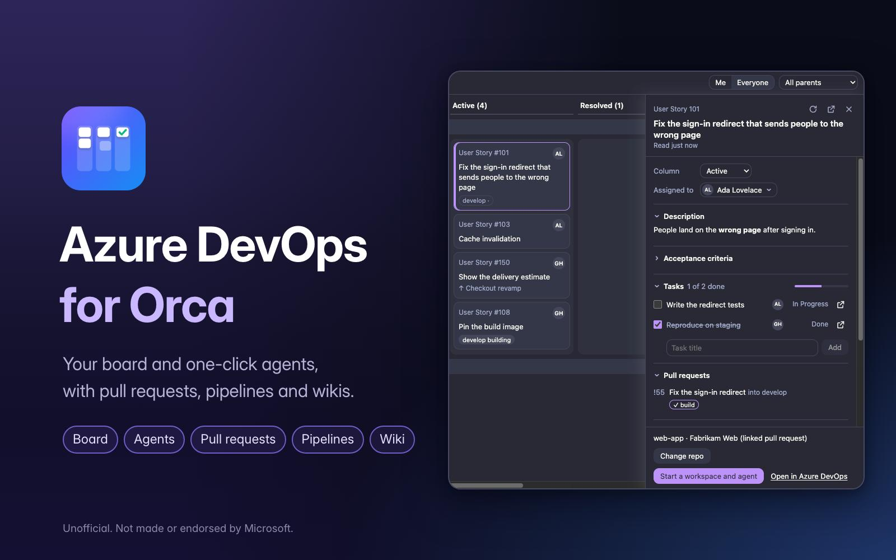
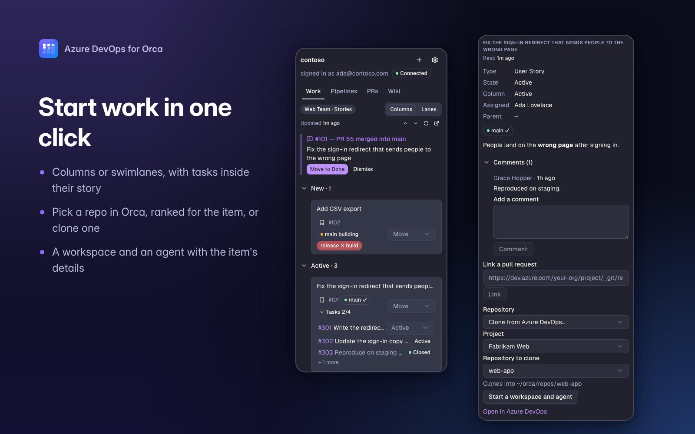
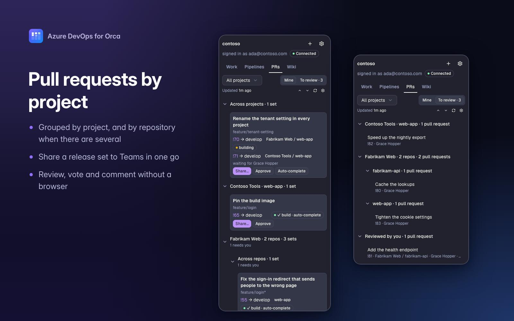
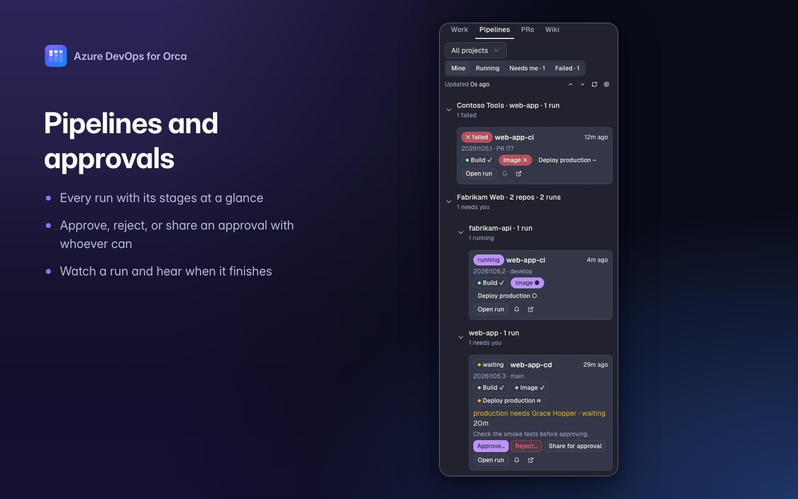
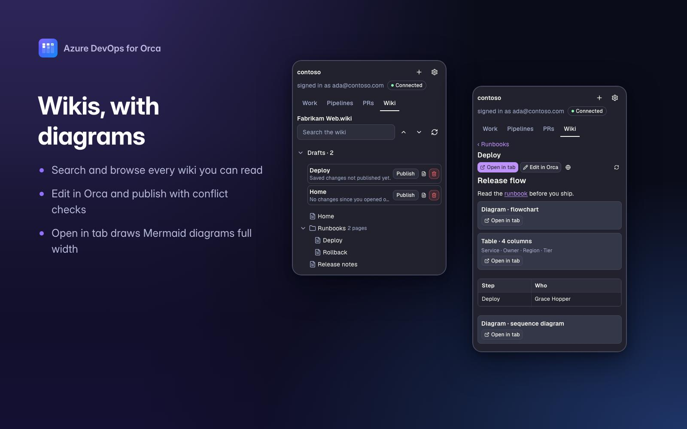

# Azure DevOps for Orca



Azure DevOps work items, boards, pull requests, pipelines and wikis in the [Orca](https://github.com/stablyai/orca) sidebar. Connect any number of organisations with the Azure CLI, a Microsoft account or a personal access token, and each one stays pinned to the account you signed in with.

Unofficial: not made or endorsed by Microsoft. Azure DevOps is a trademark of Microsoft.

## Install

Find **Azure DevOps** in Orca's plugin list ([catalog page](https://onorca.dev/plugins/kloppers-labs/orca-azure-devops)), or run:

```bash
orca plugin install kloppers-labs/orca-azure-devops
```

Orca lists what the plugin may do before you approve it, and [Permissions](docs/reference.md#permissions) explains each item. The plugin runs its own code with your account's access; community plugins are checked by machine, not reviewed by the Orca team. `orca plugin update` fetches newer releases.

Then open **Azure DevOps** in Orca's sidebar and connect an organisation, as [Connecting and signing in](docs/connecting.md) describes.

## What it does

- **Work:** your items by board column or by the board's own swimlanes, with their tasks inside them and a compact Move; a full-tab team board with drag-and-drop; a workspace or an agent started from an item. [Work guide](docs/work.md)
- **Pull requests:** release sets grouped by project, **Mine** and **To review**, Approve and Auto-complete, sharing to Teams or the clipboard, and PR reviews with diffs, votes and comment threads. [Pull requests guide](docs/pull-requests.md)
- **Pipelines:** your runs grouped by project with their stages, approvals you can give or share, and a full-tab run view with a live log and an error summary. [Pipelines guide](docs/pipelines.md)
- **Wiki:** a page tree, search, Open in tab with Mermaid diagrams drawn, and Edit in Orca with a Publish that handles conflicts. [Wiki guide](docs/wiki.md)
- **Everywhere:** desktop notifications, `ADO · N failed · N approvals · N to review` on the status bar, and proxy and certificate settings for restricted networks. [Reference](docs/reference.md)

## Screenshots

<table>
  <tr>
    <td width="50%"></td>
    <td width="50%"></td>
  </tr>
  <tr>
    <td>Your board in the sidebar, by column or by swimlane, with tasks inside their story.</td>
    <td>Pull requests grouped by project, ready to share, approve or review.</td>
  </tr>
  <tr>
    <td width="50%"></td>
    <td width="50%"></td>
  </tr>
  <tr>
    <td>Every run with its stages, and approvals you can give or share.</td>
    <td>Browse and edit wikis; Open in tab draws Mermaid diagrams full width.</td>
  </tr>
</table>

## Requirements

- Orca 1.4.248 or later.
- For Azure CLI sign-in: Azure CLI 2.54 or later.
- For Sign in with Microsoft: an app registration an admin creates once, as [Registering the app (for admins)](docs/connecting.md#registering-the-app-for-admins) describes. Without one, use the Azure CLI or a personal access token.

## Documentation

- [Connecting and signing in](docs/connecting.md): the three ways to connect, PAT scopes, troubleshooting, registering the app, and proxies and certificates
- [Work, the board and agents](docs/work.md)
- [Pull requests, sharing and reviews](docs/pull-requests.md)
- [Pipelines and runs](docs/pipelines.md)
- [The Wiki tab](docs/wiki.md)
- [Notifications, polling, settings and permissions](docs/reference.md)
- [Development](docs/development.md): building, testing, and the live checks still pending

## Feedback and security

Report problems and ideas in [Issues](https://github.com/kloppers-labs/orca-azure-devops/issues). Never paste a token, a sign-in code or a Teams webhook URL there. Report security problems privately, as [SECURITY.md](SECURITY.md) describes.

## License

[MIT](LICENSE)
